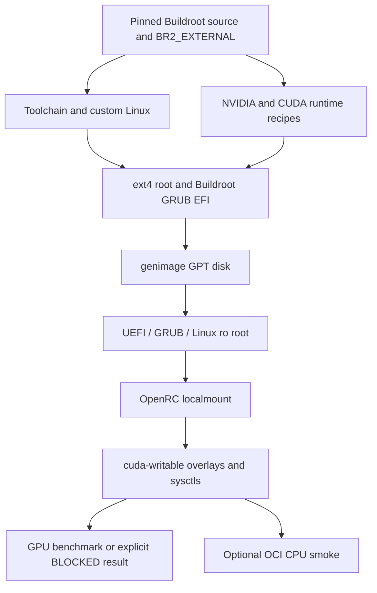

# Architecture

Recipe presence is not installation evidence. GPT checks are not boot evidence. QEMU without passthrough is not GPU evidence. The x86_64 target uses ACPI/PCI enumeration, so no device tree is applicable.
